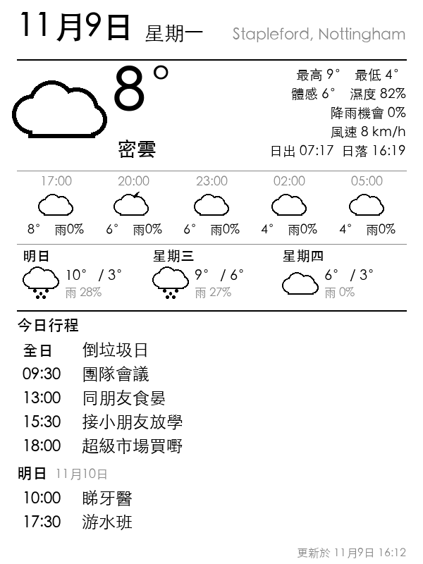

# Kindle 雪櫃天氣＋日曆屏

將舊 Kindle 4 變成貼喺雪櫃嘅顯示屏，顯示：

- 今日天氣、未來幾個鐘同未來 3 日天氣
- Google Calendar 今日同明日嘅行程
- 電量（電量低過 20% 會提你充電）
- 最後更新時間（見到時間好舊，即係有嘢出咗問題）



## 點運作

```
GitHub Actions（每 30 分鐘，免費）
  ├─ 攞天氣（Open-Meteo，免費，唔使註冊）
  ├─ 攞 Google Calendar（私人 iCal 連結）
  └─ 畫成 600×800 黑白圖，放上 GitHub Pages（秘密檔名）
        ↓
Kindle（kindle-dash）
  每次醒嚟 → WiFi 下載張圖 → 顯示 → 印埋電量 → 返去瞓
```

張圖係喺雲端畫，所以你部 Mac 唔使開住。Kindle 每日大約醒 10 次（06:10、07:10、08:10，之後每兩個鐘，最後一次 22:10），夜晚唔更新，慳電。

## 檔案

| 檔案 | 做咩 |
|---|---|
| `renderer/render.py` | 畫天氣同日曆圖（版面） |
| `renderer/data.py` | 攞天氣同日曆資料 |
| `renderer/icons.py` | 天氣圖示 |
| `renderer/config.json` | **地點、時區**等設定 |
| `.github/workflows/render.yml` | GitHub 每 30 分鐘自動畫圖同發佈 |
| `kindle/local/env.sh` | Kindle 設定：圖片網址、更新時間 |
| `kindle/local/fetch-dashboard.sh` | Kindle 下載張圖，再印電量 |

---

## 步驟 1：喺 Mac 預覽（可以跳過）

```bash
cd ~/"Kindle Project"
python3 -m venv .venv
.venv/bin/pip install -r renderer/requirements.txt
.venv/bin/python renderer/render.py --demo-calendar --out out/preview.png
open out/preview.png
```

`--demo-calendar` 用示範行程。想睇真行程，就先設定 `ICAL_URLS`（見步驟 2）：

```bash
ICAL_URLS="你的iCal連結" .venv/bin/python renderer/render.py
```

> Mac 預覽用 macOS 內置字型；GitHub 上面會用 Noto Sans CJK HK，字款會靚啲。

**改地點：**打開 `renderer/config.json`，改 `location_name`、`latitude`、`longitude`。用城市中心座標就得，唔好用屋企準確位置，因為呢個檔案會公開喺 GitHub。

## 步驟 2：攞 Google Calendar 私人連結

1. 用電腦開 [Google Calendar](https://calendar.google.com)。
2. 右上角 ⚙️ **Settings**。
3. 左邊揀你個日曆（例如你個名）。
4. 碌落去 **Integrate calendar**，複製 **Secret address in iCal format**。
5. 想顯示多過一個日曆（例如屋企人），每個日曆都複製一條，之後用空格分開。

⚠️ 呢條連結等於一條鎖匙，有咗就睇到你成個日曆。**唔好寫入任何檔案**，只放喺 GitHub Secret 入面。

## 步驟 3：放上 GitHub

1. 喺 GitHub 開一個新 repository，例如叫 `kindle-fridge`。
   GitHub Pages 免費版要 **Public**。公開嘅只係 code，你啲行程唔會出現喺 repo 入面。
2. 將呢個資料夾 push 上去。
3. 產生一個秘密檔名，喺 Terminal 行：
   ```bash
   openssl rand -hex 16
   ```
4. Repo → **Settings → Secrets and variables → Actions → New repository secret**，加兩個：
   - `DASH_SECRET`：上一步產生嘅秘密檔名
   - `ICAL_URLS`：步驟 2 嘅 iCal 連結（多條就用空格分開）
5. Repo → **Settings → Pages → Build and deployment → Source**，揀 **GitHub Actions**。
6. Repo → **Actions → Render Kindle dashboard → Run workflow**，等 1–2 分鐘。
7. 用瀏覽器開以下網址，見到天氣圖就成功：
   ```
   https://你的GitHub名.github.io/kindle-fridge/你的DASH_SECRET.png
   ```

**私隱：**張圖只可以用呢條秘密網址打開，網站冇其他頁面會連去佢，原理同 Google Calendar 嘅私人 iCal 連結一樣。唔好將條網址俾人。

> GitHub 如果 60 日冇人改過個 repo，會自動暫停排程，暫停之前會 email 你。收到 email 嘅話，去 Actions 撳返 **Enable workflow** 就得。Kindle 屏幕底部嘅「更新於」時間太舊，都可能係呢個原因。

## 步驟 4：Kindle 越獄同安裝

> 第一次做，建議逐步問我，我陪你做。

1. **確認韌體版本**：Home → Menu → Settings → Menu → Device Info。
   越獄方法支援 4.0.0 至 4.1.4，即係所有 Kindle 4 韌體。
2. **越獄（jailbreak）**：跟 MobileRead 嘅 Kindle 4 NT 教學：
   <https://wiki.mobileread.com/wiki/Kindle4NTHacking>
   成功之後，Kindle 會出現一本叫「You are Jailbroken」嘅書。
3. **升級韌體到 4.1.4**：KUAL 用嘅開發者證書喺 2025 年 4 月過期，新證書（DevCerts 20250419）要 4.1.4 先用得。
   韌體唔可以跳級，要 4.1.1 → 4.1.2 → 4.1.3 → 4.1.4 逐級升。檔案來自 Amazon：
   <https://www.amazon.com/gp/help/customer/display.html?nodeId=GX3VVAQS4DYDE5KE>
4. **安裝 MKK，再裝新證書（DevCerts）**：檔案來自 MobileRead：
   <https://www.mobileread.com/forums/showthread.php?t=225030>
   - MKK：`kindle-mkk-20141129-r18833.tar.xz` 入面嘅 `Update_mkk-20141129-k4-ALL_install.bin`
   - DevCerts：`DevCerts-20250419-KeyStore.zip` 入面嘅 `Update_mkk-20250419-k4-ALL_keystore-install.bin`

   第 3、4 步每個 `.bin` 都係咁裝：
   1. 放喺 Kindle 根目錄，**一次只放一個**。
   2. 安全退出，拔線。
   3. Kindle 撳 **Menu → Settings → Menu → Update Your Kindle**，等佢裝完、自己重開機。
5. **安裝 KUAL**：將 `KUAL-v2.7.37-gfcb45b5-20250419.tar.xz` 入面嘅 `KUAL-KDK-1.0.azw2` 放入 Kindle 嘅 `documents` 資料夾。
   ⚠️ **唔好用 KUAL Booklet 嘅 `.bin`**，Kindle 4 用唔到。如果用咗，會出 "Main class instantiation threw a RuntimeException"，要跑返 `Update_KUALBooklet_v2.7.37_uninstall.bin` 先修得返。
6. **安裝 kindle-dash**（呢個程式專門試過 Kindle 4 NT）：
   <https://github.com/pascalw/kindle-dash/releases>
   1. 解壓之後，用呢個資料夾嘅 `kindle/local/env.sh` 同 `kindle/local/fetch-dashboard.sh`，**取代** kindle-dash 入面 `local/` 嘅同名檔案。
   2. 打開 `env.sh`，將 `DASH_URL` 改成步驟 3 第 7 點嘅網址。
   3. 將成個資料夾複製去 Kindle 根目錄，改名做 `dashboard`。
   4. 將呢個資料夾嘅 `kindle/KUAL/kindle-dash` 複製去 Kindle 嘅 `extensions` 資料夾。如果 Kindle 冇 `extensions` 資料夾，就自己開一個。
7. 安全退出 Kindle。喺主頁打開 **KUAL** 嗰本書，揀 **Kindle Dashboard**。大約 15 秒之後，Kindle 會開始顯示天氣，然後入睡。

> 用 KUAL 之前，Kindle 要**登記咗 Amazon 帳戶**，或者**保持離線**。登記取消咗但又連住 WiFi，MKK 會失效，要重新安裝 MKK 同 DevCerts。

## 日常使用

- **充電**：直接插線就得，唔使停程式。
- **想用返 Kindle 睇書**：㩒住底部電源掣大約 20 秒，Kindle 重新開機就會變返正常。之後喺 KUAL 撳 Start 就再開始。
- **電量**：每次更新都會喺左下角顯示 `Battery 65%`；低過 20% 會顯示 `LOW BATTERY`。
- **電量字出錯位置**：改 `env.sh` 嘅 `BATTERY_COL`、`BATTERY_ROW`。
- **改更新時間**：改 `env.sh` 嘅 `REFRESH_SCHEDULE`。
- **改版面**：改 `renderer/render.py`，push 上 GitHub 就會自動更新。
